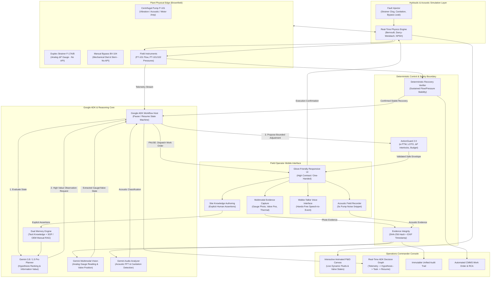

# Plant Debugger Next-Gen: Architecture & Feature Specification
*Bridging the Industrial "Last Meter" with Multi-Modal AI, Deterministic Safety Boundaries, and Physical Human Reach*

---

## 1. Executive Summary & Core Philosophy

Brownfield industrial facilities (chemical plants, refineries, water treatment stations, power plants) operate in a hybrid reality:
- **Central Telemetry** can register an anomaly (e.g. low discharge flow at pump `P-101`), but cannot reach into the physical world.
- **The "Last Meter"**—local differential pressure ($\Delta P$) needle gauges, physical valve stem positions, strainer cleanout flanges, acoustic cavitation rumble, and maintenance aisle clearances—**has no API**.
- Full automation with remote actuators on every brownfield line is economically and physically unfeasible; deterministic DCS/PLC logic cannot reason about uninstrumented local indicators.

**Plant Debugger Next-Gen** transforms the field operator from a passive "approval button clicker" into an active **sensory and physical interface** for a multi-modal AI agent:
- **Google ADK + Gemini** plans the diagnostic investigation, requesting specific physical observations and bounded manual experiments.
- **Resumable Dynamic Workflows** pause execution (`RequestInput` $\rightarrow$ `PAUSE`) until the physical world responds, and resume (`FunctionResponse` $\rightarrow$ `RESUME`) when verified evidence arrives.
- **Deterministic Code (ActionGuard & Telemetry Verifier)** acts as the safety interlock: the LLM never has the authority to exceed safe physical operating bounds or declare an incident resolved.

---

## 2. Comparison: Original Concept vs. Next-Gen Evolution

| Dimension | Original Concept | Next-Gen Evolution (Plant Debugger Pro) |
| :--- | :--- | :--- |
| **Asset Topology** | Single pump & valve (`P-101`, `F-17`, `BV-104`) | **Full Hydraulic Subsystem**: Suction vessel, Duplex Strainer `F-17A/B`, Centrifugal Pump `P-101`, Throttle Bypass `BV-104`, Discharge Control Valve `FCV-102`, and Heat Exchanger `HEX-101`. |
| **Physics Simulation** | Simple linear flow attenuation | **Real-Time Hydraulic & Acoustic Physics Engine**: Darcy-Weisbach friction, pump affinity head-flow curves ($H$-$Q$), NPSH calculation, vapor pressure cavitation, and valve $C_v$ curves. |
| **Sensory Modalities** | Static photo (gauge $\Delta P$ & valve position) | **Tri-Modal Field Evidence**: <br>1. **Vision**: Gauge reading & valve stem position.<br>2. **Acoustic**: 5-second audio snippet analysis (normal hum vs. impeller cavitation vs. bearing dry-run).<br>3. **Thermal / Visual Sight-Glass**: Flange leak detection, bearing heat check, lube oil clarity. |
| **Safety Architecture** | Basic delta limits (`delta_pct`) | **Digital Permit-to-Work (e-PTW) & LOTO Engine**: Pre-action PPE verification via camera, differential pressure interlocks, thermal hazard checks, deadman rollback timers, and step budgets. |
| **Operator Memory** | Conservative Firestore Site Knowledge | **Dual-Memory Provenance Engine**: <br>1. Conservative operator tacit assertions (never hallucinated).<br>2. Approved Plant SOPs & OEM Equipment Manual RAG with strict citation grounding. |
| **Operator Interface** | Mobile browser form | **Hands-Free Field Walkie-Talkie (Gemini Audio / Speech)**: Voice-guided inspections, high-contrast glove-friendly mobile UI with AR-style bounding overlays. |
| **Commander UI** | Telemetry charts & basic log | **Interactive Animated P&ID Canvas**: Real-time fluid flow visualization, valve open/close animations, live gauge needles, interactive fault injection console, and live ADK Decision Graph. |
| **Post-Incident** | Deterministic `RESOLVED` state | **Automated CMMS Work Order & 5-Why RCA Generator**: Generates SAP/IBM Maximo-ready work orders, Root Cause Analysis, and SHA-256 sealed audit packages. |

---

## 3. High-Level Architecture Diagram



---

## 4. Key Advanced Functional Modules

### 4.1. Real-Time Hydraulic & Acoustic Physics Engine (`plant-sim`)
Instead of fixed state transitions, the simulation runs a genuine 1 Hz discrete fluid dynamics cycle:
- **Bernoulli & Darcy-Weisbach flow calculation**:
  $$Q = C_v \sqrt{\frac{\Delta P}{SG}}$$
- **Pump Performance Curve**: Differential head $H = H_0 - A \cdot Q^2$ with motor amperage scaling proportionally with hydraulic load.
- **Cavitation Detection**: Calculates Net Positive Suction Head Available ($NPSH_A$) vs. Required ($NPSH_R$). When suction strainer $F\text{-}17$ clogs, suction pressure drops below liquid vapor pressure ($P_v$), triggering realistic cavitation physics.
- **Acoustic Audio Synthesis**: Dynamically generates real WAV audio of the pump running (baseline 60Hz electromagnetic hum + broadband white noise + high-frequency "gravel" crackle when cavitation occurs).

### 4.2. Tri-Modal Field Evidence Classification (Gemini 1.5/3.8 Flash & Pro)
1. **Differential Pressure Gauge Vision**:
   - Model reads the analog needle on differential scale (0 to 25 psi / 0 to 1.8 bar).
   - Classifies: `NORMAL` ($\le 3 \text{ psi}$), `ELEVATED` ($3 \text{--} 8 \text{ psi}$), `CLOGGED/CRITICAL` ($> 8 \text{ psi}$), or `UNCERTAIN` (glare, dirty faceplate, needle obscured).
   - Generates bounding box coordinates for visual explainability on the Commander screen.
2. **Physical Valve Stem / Dial Position Vision**:
   - Classifies manual throttle valve $BV\text{-}104$: `FULLY_CLOSED`, `PARTIALLY_OPEN_PROBE` ($\sim 10\%\text{--}30\%$), `FULLY_OPEN` ($90\%\text{--}100\%$), or `DISCREPANCY`.
   - Requires final-position verification photo whenever 100% OPEN is commanded.
3. **Acoustic Waveform Analysis**:
   - Audio snippet sent to Gemini Multimodal Audio.
   - Prompt analyzes audio frequency distribution: differentiates between normal mechanical vibration, impeller cavitation (pumping marbles/gravel), and bearing squeal.

### 4.3. Digital Safety Interlocks (ActionGuard 2.0 & e-PTW)
Real industrial sites enforce OSHA / Process Safety Management (PSM) rules:
- **Rate-of-Change Limit**: An operator is never permitted to turn a manual valve more than $\Delta 25\%$ in a single step to prevent water hammer.
- **Differential Pressure Safety Threshold**: If $\Delta P$ across $BV\text{-}104 > 5 \text{ bar}$, rapid manual opening could damage downstream seals; ActionGuard rejects the step and instructs a slow equalization crack ($5\%$).
- **Deadman Action Budget**: Maximum of 5 manual interventions per incident before mandatory shift supervisor escalation.
- **Step Rollback Safeguard**: If flow degrades further after an action, an emergency "One-Click Safe Park" sequence is immediately presented.

### 4.4. Dual-Memory Engine: Tacit Site Knowledge + Plant SOP RAG
- **Conservative Tacit Knowledge**: Human operator notes (e.g. *"Strainer F-17 DP gauge needle sticks occasionally; tap faceplate lightly"* or *"West aisle has temporary pipe rack obstruction; use North gantry"*) are stored in Firestore with operator credentials. Only human inputs become permanent memory.
- **Plant SOP & Manual RAG**: Ingests OEM pump operational manuals and Standard Operating Procedures (`SOP-PR-04: Clearing Centrifugal Pump Low-Flow Anomalies`).
- **Context Injection**: ADK generates work orders with grounded references:
  > *"Proceed to Strainer F-17 via North gantry (West aisle obstructed per Operator Assertion #42). Follow SOP-PR-04 Section 3.2. Tap gauge lightly if needle appears static."*

### 4.5. Interactive Commander & Mobile Field Companion UI
- **Commander Dashboard (Desktop)**:
  - Vector/SVG interactive P&ID with real-time fluid animation (lines turn cyan/blue for flow, flashing amber/red for restriction).
  - Live charts: Flow rate ($FT\text{-}101$), Suction pressure ($PT\text{-}101$), Discharge pressure ($PT\text{-}102$), Differential pressure ($\Delta P$), Motor Current ($IT\text{-}101$).
  - Live ADK Reasoning Graph displaying hypotheses, confidence scores, and current pause state.
  - Interactive Fault Injection Panel to trigger real-world failure scenarios on the fly.
- **Field Operator Companion (Mobile / Tablet)**:
  - High-contrast, industrial UI with extra-large touch targets for gloved operation.
  - Step-by-step guidance card with single clear action.
  - Built-in camera capture with instant mock test patterns or real photo upload.
  - Built-in audio recorder with synthetic acoustic generator or real mic recording.
  - Voice Walkie-Talkie toggle to speak directly to the assistant.

### 4.6. Automated Post-Incident CMMS Work Order & RCA Package
Once the deterministic verifier confirms sustained recovery ($\ge 30 \text{ seconds}$ of nominal flow $\pm 5\%$ at steady motor current):
- Automatically produces a **5-Why Root Cause Analysis**.
- Formats an **Industrial Maintenance Work Order** (compatible with SAP PM / Maximo) for pipefitters to service the clogged strainer basket during next planned turnaround.
- Compiles an **Immutable Audit Trail** containing every telemetry timestamp, Gemini prompt/response, photo SHA-256 hash, and operator acknowledgement.

---

## 5. Technology Stack & Directory Layout

```
plant-debugger-pro/
├── backend/
│   ├── app/
│   │   ├── main.py                     # FastAPI application entrypoint
│   │   ├── config.py                   # Environment configuration (Gemini API, Firestore, Storage)
│   │   ├── sim/
│   │   │   ├── engine.py               # Hydraulic & acoustic simulation loop (1 Hz)
│   │   │   ├── models.py               # Plant asset state models (P-101, F-17, BV-104, FT-101)
│   │   │   └── acoustic_synth.py       # Realistic pump audio waveform generator
│   │   ├── agent/
│   │   │   ├── workflow.py             # Resumable Google ADK dynamic workflow (Pause / Resume)
│   │   │   ├── planner.py              # Gemini reasoning & hypothesis generation
│   │   │   ├── vision.py               # Gemini Vision gauge & valve position classifier
│   │   │   ├── acoustic.py             # Gemini Audio pump sound classifier
│   │   │   └── action_guard.py         # Deterministic safety boundaries & e-PTW interlocks
│   │   ├── memory/
│   │   │   ├── site_knowledge.py       # Firestore-backed conservative operator memory
│   │   │   └── sop_rag.py              # Plant SOP & OEM manual retrieval
│   │   ├── verification/
│   │   │   ├── deterministic.py        # Telemetry recovery verifier
│   │   │   └── rca_generator.py        # 5-Why & CMMS work order generator
│   │   └── api/
│   │       ├── routes_telemetry.py     # Live telemetry SSE / WebSocket endpoint
│   │       ├── routes_evidence.py      # Photo/audio upload with SHA-256 validation
│   │       ├── routes_operator.py      # Mobile operator task dispatch & confirmations
│   │       ├── routes_knowledge.py     # Site knowledge CRUD
│   │       └── routes_sim.py           # Fault injection & reset endpoints
│   └── requirements.txt
├── frontend/
│   ├── src/
│   │   ├── components/
│   │   │   ├── pid/
│   │   │   │   ├── PIDCanvas.tsx       # Animated SVG/Canvas P&ID with fluid flow
│   │   │   │   └── AssetNode.tsx       # Clickable equipment nodes (Pump, Strainer, Valves)
│   │   │   ├── commander/
│   │   │   │   ├── TelemetryTrends.tsx # Real-time charts (Flow, Pressure, Current)
│   │   │   │   ├── DecisionTrace.tsx   # ADK Live Decision Tree visualization
│   │   │   │   ├── FaultInjector.tsx   # Simulator fault control panel
│   │   │   │   └── AuditTrail.tsx      # Cryptographic event log
│   │   │   ├── operator/
│   │   │   │   ├── MobileTaskCard.tsx  # Gloved-hand operator task instructions
│   │   │   │   ├── CameraCapture.tsx   # Gauge/valve photo capture with AI preview
│   │   │   │   ├── AcousticCapture.tsx # 5-second audio pump recording widget
│   │   │   │   ├── ValveSlider.tsx     # Bounded manual valve adjustment control
│   │   │   │   └── KnowledgeModal.tsx  # Explicit site assertion authoring
│   │   │   └── common/
│   │   │       └── Header.tsx
│   │   ├── App.tsx                     # Main layout with Commander / Operator role switcher
│   │   └── main.tsx
│   ├── package.json
│   ├── tailwind.config.js
│   └── vite.config.ts
└── README.md
```

---

## 6. Verification & Demonstration Scenarios

1. **Scenario 1: Duplex Strainer F-17 Restriction with Bypass Routing (The Primary Run)**
   - Telemetry triggers low flow on $FT\text{-}101$ ($32 \text{ gpm}$ vs nominal $100 \text{ gpm}$).
   - ADK pauses to request analog gauge photo of $F\text{-}17$.
   - Gemini Vision reads needle: $\Delta P = 14 \text{ psi}$ (HIGH).
   - ADK plans $10\%$ probe opening of manual bypass $BV\text{-}104$.
   - Operator confirms adjustment; telemetry recovers partially to $55 \text{ gpm}$.
   - ADK recognizes incomplete recovery; commands full open to mechanically marked OPEN.
   - Operator uploads end-state photo; Gemini Vision verifies OPEN position.
   - Deterministic verifier checks sustained 30s healthy telemetry $\rightarrow$ `RESOLVED`.
   - Automatic 5-Why RCA and SAP Work Order generated.

2. **Scenario 2: Pump Impeller Cavitation vs. Bearing Failure (Acoustic Modality)**
   - Low flow accompanied by abnormal noise; visual inspection of strainer is inconclusive.
   - Operator records 5-second audio snippet at pump $P\text{-}101$ casing.
   - Gemini Audio classifies acoustic spectrum: confirms cavitation ("gravel rattle" at $4\text{--}8 \text{ kHz}$ band) caused by suction depression.

3. **Scenario 3: Operator Tacit Knowledge Learning Across Incidents**
   - Operator submits site fact: *"Bypass valve BV-104 wheel has 1.5 turns of mechanical backlash before stem moves."*
   - Next incident automatically incorporates this fact into the work order: *"Compensate for 1.5 turns backlash before setting 20% mark."*
